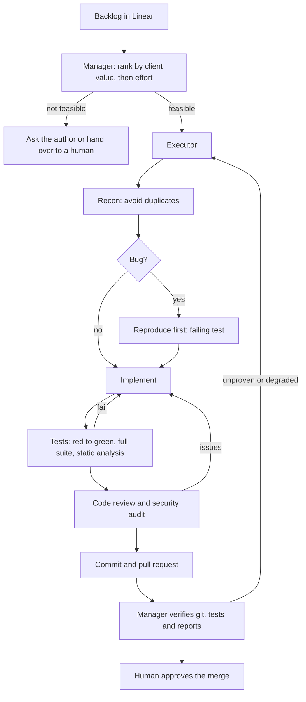

# Agentic Software Factory: case study

An autonomous ticket loop for a production SaaS backend (Laravel, PHP). AI agents take a ticket from the backlog to a reviewed pull request, and a human approves the merge.

> The code is private, because it belongs to a client project. This page describes the process, the roles and the safeguards.

## Roles

- **Manager agent.** Ranks tickets by value to a non-technical client, then by effort. It scores feasibility against a rubric, asks the right person when context is missing, hands one ticket to an executor and supervises it. It never writes code and keeps its own context small, so it can run for long periods.
- **Executor agent.** Owns one ticket from start to finish: recon, reproduction of bugs, implementation, tests, review, commit and pull request. It delegates every phase to a specialist.
- **Specialists.** Recon, implementation, tests, code reviewer and security auditor. Each runs as a native subagent or as a separate agent in its own terminal pane, depending on the model configured for the role.

## Flow

## Safeguards

- **Entry gate.** If reproduction data or acceptance criteria are missing, the ticket is escalated instead of guessed.
- **Proof gate.** A bug fix must show the same test failing before and passing after, plus a happy-path assertion. The full suite (Pest, PHPStan) must be green.
- **Mandatory review.** A code review and a security audit are required. A skipped or degraded review means the ticket is not done.
- **Claims are verified.** The executor's "done" is treated as a claim. The manager checks the commit, re-runs the tests and reads the full report before anything is pushed.
- **Push lock.** A Git pre-push hook blocks pushes until the manager's verification passes. Agents never merge.
- **Five-minute rule.** A confirmed finding outside the ticket's scope is fixed on the spot if it takes five minutes or less. Otherwise it becomes a new ticket, so nothing stays only in a log.
- **Liveness watchdog.** Detects stalled agents (API errors, usage limits, full context, a pending question) and recovers automatically. It wakes the manager only when recovery fails.
- **Self-improving loop.** Every correction from a human is distilled into a single rule and added to the selection criteria, the hard gates or the lessons file.

## Model-agnostic by configuration

One config file assigns an agent, a model and an effort level to every role (Claude Code, Antigravity with Gemini, Codex). Moving a role to another vendor is a config change, not a code change.

## Human in the loop

Milestones (started, tests green, review done, pull request ready, escalated) reach the human on Telegram. The loop runs unattended and can be steered from a phone.

## Stack

Claude Code · Antigravity · Codex · Linear · herdr (terminal workspace for agents) · Git hooks · Pest · PHPStan · Telegram
